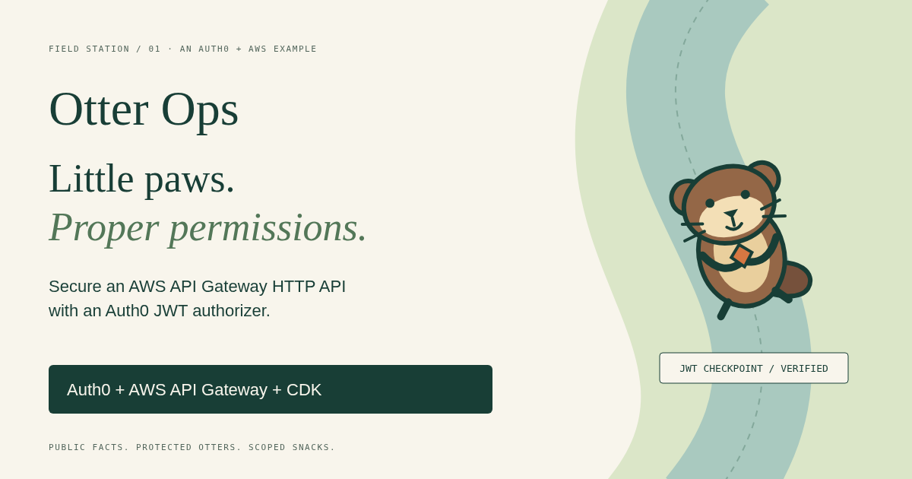
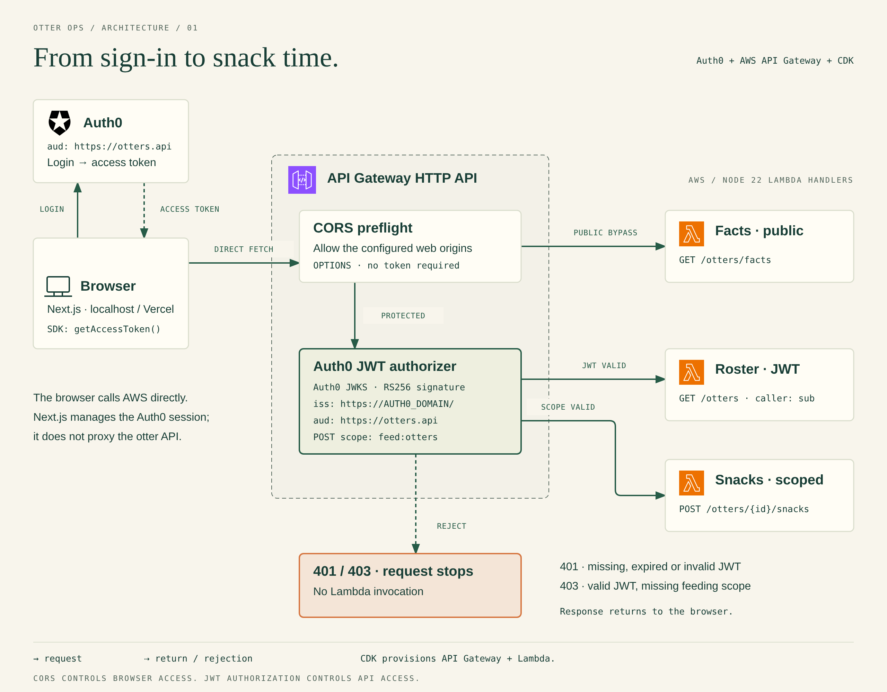

# Otter Ops

**Little paws. Proper permissions.** A fullstack example for **“Secure an AWS
API Gateway HTTP API with an Auth0 JWT authorizer.”** Meet the raft, deliver a
snack, and watch API Gateway enforce the security boundary before Lambda runs.

Topics: `Auth0` · `AWS API Gateway HTTP API` · `JWT authorizer` · `AWS CDK` ·
`Lambda` · `Next.js` · `CORS` · `TypeScript`



## Architecture



[Full-size HTML](docs/architecture.html) · [Vector SVG](docs/architecture.svg)
· [Artwork sources and attribution](docs/ATTRIBUTION.md)

## How it works

1. Next.js uses Auth0's v4 SDK. `/auth/login` starts Universal Login;
   `/auth/callback` establishes the encrypted session. Next 16's `proxy.ts`
   handles the SDK endpoints and session lifecycle.
2. `Auth0Client.authorizationParameters` requests audience **`https://otters.api`**
   and scopes **`openid profile email feed:otters`**. The audience is an API
   identifier, not necessarily a URL you can visit.
3. In the browser, `getAccessToken()` from `@auth0/nextjs-auth0` retrieves the
   session's access token via the SDK's same-origin endpoint. The browser calls
   API Gateway **directly**, with `Authorization: Bearer <access-token>`.
   There is no Next.js proxy for the otter routes. Do not send an ID token.
4. API Gateway's CORS configuration permits the configured web origins,
   GET/POST/OPTIONS, and `authorization` / `content-type`. Cross-origin Bearer
   requests trigger a browser OPTIONS preflight, which does not require a JWT.
5. The JWT authorizer checks the Auth0 signature against its JWKS, issuer,
   audience and token validity. The feeding route also requires `feed:otters`.
   Accepted requests reach Node 22 Lambda handlers, which read the caller from
   `event.requestContext.authorizer.jwt.claims.sub`.

| Route | Authorization | Result |
| --- | --- | --- |
| `GET /otters/facts` | Public — no authorizer | Fun otter facts |
| `GET /otters` | Valid JWT | Roster and caller subject |
| `POST /otters/{id}/snacks` | Valid JWT + `feed:otters` | Snack response and caller subject |

Feeding accepts JSON such as `{"snack":"clam"}`. It returns 400 for invalid or
empty bodies and 404 for unknown otters. This playful, stateless example does
not persist feeding history.

**Why both CORS and JWT authorization?** CORS tells a *browser* whether a web
origin may make/read a cross-origin request. It does not authenticate callers:
curl and other nonbrowser clients are not restricted by CORS. The JWT authorizer
verifies identity and route scopes independently. A permitted origin without a
token still gets **401**; a valid token without the feeding scope gets **403**
on POST. Both rejections happen before Lambda. The UI's “Call without token”
button demonstrates the first case.

## Prerequisites

- Node **22 LTS** and npm (`nvm use` reads `.nvmrc`).
- An Auth0 tenant for local sign-in and JWTs.
- For deployment: AWS CLI credentials, an AWS account/region, and permission
  to bootstrap/deploy a CDK stack. AWS resources may incur charges.
- Optional: Vercel for hosting the Next.js app.

## Auth0 setup

1. In **Applications → APIs → Create API**, create **Otter Ops** with identifier
   **`https://otters.api`** and signing algorithm **RS256**. In **Permissions**,
   add **`feed:otters`** (description: “Feed an otter a snack”). Use that exact
   identifier as `AUTH0_AUDIENCE` in the web app and infra.
2. In **Applications → Applications**, create a **Regular Web Application**.
   Record its domain (hostname only), client ID and client secret. This is a
   confidential Next.js application, not an SPA application type; secrets stay
   on the Next.js server and never use a `NEXT_PUBLIC_` prefix.
3. Configure and save these application URLs:

   | Setting | Local value |
   | --- | --- |
   | Allowed Callback URLs | `http://localhost:3000/auth/callback` |
   | Allowed Logout URLs | `http://localhost:3000` |
   | Allowed Web Origins | `http://localhost:3000` |

4. Enable a connection your test user can use. Ensure the application's API
   access/consent policy permits the requested audience and scope. If **RBAC**
   is enabled on the API, create a role with `feed:otters` and assign it to the
   test user. The permission must appear in the access token's **`scope`**
   (or `scp`) claim; a `permissions` array alone is not what this route checks.
   Sign out/in after changing grants. Keep consent policies appropriate for
   your tenant rather than disabling consent globally for this demo.

## Run locally — no AWS required

```sh
nvm use
npm ci
cp web/.env.example web/.env.local
cp infra/.env.example infra/.env.local
openssl rand -hex 32  # use the result as AUTH0_SECRET; never commit it
```

Edit `web/.env.local`, replacing the placeholders with your application's values:

```dotenv
AUTH0_DOMAIN=your-tenant.us.auth0.com
AUTH0_CLIENT_ID=your-client-id
AUTH0_CLIENT_SECRET=your-client-secret
AUTH0_SECRET=your-random-64-character-hex-secret
APP_BASE_URL=http://localhost:3000
AUTH0_AUDIENCE=https://otters.api
AUTH0_SCOPE=openid profile email feed:otters
NEXT_PUBLIC_API_URL=http://localhost:4000
```

Edit `infra/.env.local` — the API needs **no client secret**:

```dotenv
AUTH0_DOMAIN=your-tenant.us.auth0.com
AUTH0_AUDIENCE=https://otters.api
ALLOWED_ORIGINS=http://localhost:3000
```

```sh
npm run dev
```

Open **http://localhost:3000**. Load public facts while logged out, try the
tokenless call, then sign in to load the raft and feed an otter. Requests and
responses appear in the UI panel; access tokens are never displayed.

`npm run dev` runs web on :3000 and the API stand-in on :4000; Ctrl+C stops both.
`npm run dev:api` runs only the API. `npm run dev -w web` runs only Next.js.

The **local teaching stand-in is not AWS API Gateway**. It binds to loopback,
fetches Auth0's JWKS, verifies RS256 signatures, issuer, audience and token times,
requires `feed:otters` for POST, and calls the **same Lambda handlers**. It mirrors
this example's CORS and 401/403 boundary, not AWS's quotas, logging, deployment
stages, or precise key-cache behavior. It requires `exp` and `iat` claims. Tests
use local signing keys so the suite needs no Auth0 or AWS credentials.

Quick checks with both servers running:

```sh
curl -i -H 'Origin: http://localhost:3000' http://localhost:4000/otters/facts
curl -i http://localhost:4000/otters   # 401 {"message":"Unauthorized"}
curl -i -X OPTIONS http://localhost:4000/otters/miso/snacks \
  -H 'Origin: http://localhost:3000' \
  -H 'Access-Control-Request-Method: POST' \
  -H 'Access-Control-Request-Headers: authorization,content-type'
```

## The CDK security boundary

Key pieces from [`OttersApiStack`](infra/lib/otters-api-stack.ts), with route
integrations abbreviated:

```ts
const api = new HttpApi(this, 'OttersApi', {
  corsPreflight: {
    allowOrigins: origins, // ALLOWED_ORIGINS split on commas
    allowMethods: [CorsHttpMethod.GET, CorsHttpMethod.POST, CorsHttpMethod.OPTIONS],
    allowHeaders: ['authorization', 'content-type'],
    maxAge: Duration.hours(1),
  },
});
const authorizer = new HttpJwtAuthorizer('Auth0', `https://${domain}/`, {
  jwtAudience: [audience],
});
api.addRoutes({
  path: '/otters/facts', methods: [HttpMethod.GET],
  integration: factsIntegration, // deliberately no authorizer
});
api.addRoutes({
  path: '/otters', methods: [HttpMethod.GET],
  integration: rosterIntegration, authorizer,
});
api.addRoutes({
  path: '/otters/{id}/snacks', methods: [HttpMethod.POST],
  integration: snacksIntegration, authorizer,
  authorizationScopes: ['feed:otters'],
});
```

`AUTH0_DOMAIN` is a hostname without `https://` or a trailing slash. The stack
constructs the issuer with both. Config comes from environment variables or CDK
context (`-c AUTH0_DOMAIN=... -c AUTH0_AUDIENCE=...`); environment takes precedence.
Missing domain/audience stops synth clearly. `ALLOWED_ORIGINS` defaults to
`http://localhost:3000`. Use exact origins, including scheme and port but no path
or trailing slash; comma-separate multiple origins.

## Deploy to AWS and Vercel

From the repository root, with AWS credentials already configured:

```sh
export AWS_REGION=us-east-1
export AUTH0_DOMAIN=your-tenant.us.auth0.com
export AUTH0_AUDIENCE=https://otters.api
export ALLOWED_ORIGINS=http://localhost:3000

# Once per target AWS account/region:
(cd infra && npx cdk bootstrap "aws://$(aws sts get-caller-identity --query Account --output text)/$AWS_REGION")
npm run synth
npm run deploy
```

CDK prints **`OttersApiStack.ApiUrl`**. Put it in `web/.env.local` as
`NEXT_PUBLIC_API_URL` (no route suffix), then restart the web app. CDK commands
do **not** automatically load `infra/.env.local`; export variables as above or
pass CDK context. The `.env.local` loader belongs to local dev only.

To host the web app on Vercel:

1. Import the monorepo, choose **Next.js** and root directory **`web`**, and enable
   access to files outside that directory for the npm workspace/lockfile if
   prompted. Prefer a stable project/production hostname over allowing arbitrary
   preview origins.
2. Configure every variable from `web/.env.example` in Vercel. Set
   `NEXT_PUBLIC_API_URL` to CDK's `ApiUrl`, `APP_BASE_URL` to
   `https://your-project.vercel.app`, and use the same Auth0 audience/scopes.
   Generate a separate production `AUTH0_SECRET`. Keep secrets server-only.
3. Add `https://your-project.vercel.app/auth/callback` to Auth0's callbacks;
   add `https://your-project.vercel.app` to its logout URLs and web origins.
   Keep local entries if you still use local development.
4. Redeploy the API with the web origin explicitly permitted:

   ```sh
   export ALLOWED_ORIGINS=http://localhost:3000,https://your-project.vercel.app
   npm run deploy
   ```

5. Build/deploy the web app. `NEXT_PUBLIC_API_URL` is embedded at build time;
   redeploy after changing it. No API client secret is ever sent to AWS Lambda.

Clean up the demo when finished: `(cd infra && npx cdk destroy)` with the same
Auth0 configuration exported. Destroying this stack does not remove the shared
CDK bootstrap stack; review its resources separately.

## Tests and checks

```sh
npm run lint           # infra TypeScript + web ESLint
npm test               # handler, CDK Template, and local JWT/CORS tests
npm run build          # infra typecheck + Next.js production build
AUTH0_DOMAIN=example.auth0.com AUTH0_AUDIENCE=https://otters.api npm run synth
```

Handler tests cover public facts, caller claims, snack validation and unknown
otters. CDK assertions cover issuer/audience, CORS, public/protected routes and
POST scope. Emulator tests cover signed tokens, invalid issuer/audience/time/
signature, missing scopes, public access and allowed/disallowed preflights.
CI runs install, lint, tests, synth with dummy Auth0 config, and `next build`.

## Project structure

```text
docs/                       Architecture HTML/SVG/PNG, OG artwork and sources
infra/
  bin/app.ts                CDK entry point
  lib/otters-api-stack.ts    HTTP API, JWT authorizer, CORS and Lambda wiring
  lambda/                   Shared facts, roster and snack handlers + data
  local/                    Local Node HTTP/JWKS stand-in
  test/                     Vitest handler, stack and HTTP tests
web/
  app/                      App Router UI, CSS and inline SVG river marks
  lib/auth0.ts              Auth0Client audience/scope configuration
  proxy.ts                  Auth0 v4 session/auth endpoints for Next 16
.github/workflows/ci.yml     Workspace checks
```

## Troubleshooting

| Symptom | Check |
| --- | --- |
| CORS / “Failed to fetch” | Compare the browser's exact `Origin` with `ALLOWED_ORIGINS`, then redeploy the API. Ensure unauthenticated OPTIONS allows `authorization,content-type`. Inspect preflight in DevTools; CORS can hide an underlying API error. |
| 401 despite signing in | Use an **access token**, not ID token. Its `aud` must match `AUTH0_AUDIENCE` and `iss` must match `https://AUTH0_DOMAIN/`. Check expiration, clock, tenant/custom domain consistency and JWKS reachability. Sign out/in after audience changes. |
| 403 when feeding | Token `scope` must contain exactly `feed:otters`. Request it in `AUTH0_SCOPE`, define the API permission, and grant the user/role when RBAC is on. A `permissions` array alone is insufficient. Obtain a fresh token after grant changes. |
| Callback/logout rejected | Save exact app URLs in Auth0, including callback path and local port. Update `APP_BASE_URL` for Vercel. |
| Local API exits immediately | Create `infra/.env.local` with domain/audience; omit `https://` from the domain. Check :4000 is free. |
| Web calls an old API URL | Restart `next dev`, or rebuild/redeploy production after changing `NEXT_PUBLIC_API_URL`. |
| CDK cannot synthesize | Export domain/audience or pass context; CDK does not read the dev env file. Check Node 22 and dependencies. |

## License and artwork

Code and original river illustrations: [MIT](LICENSE). AWS/Auth0 marks retain
their respective ownership; see [attribution](docs/ATTRIBUTION.md).
The self-contained diagram uses the app's palette and system-font stacks;
[artwork rebuild notes](docs/style-guide.md) include the skill exporters.
